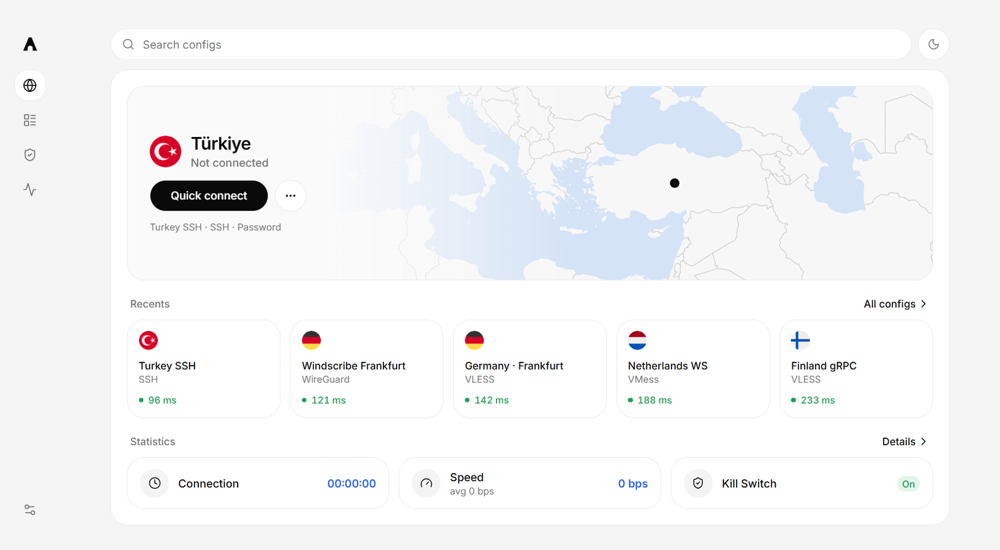

<p align="center">
  
</p>

<h1 align="center">Anti VPN</h1>

<p align="center">
  A minimal desktop VPN client for Windows and macOS for <b>V2Ray</b>, <b>SSH</b>, <b>WireGuard</b> and <b>OpenVPN</b> configs, with a real Kill Switch.
  <br />
  <a href="README.fa.md">فارسی</a>
</p>

<p align="center">
  <a href="https://github.com/TahaHosseinpour/anti-vpn/releases/download/v1.1.0/AntiVPN-Setup-1.1.0.exe"><b>⬇ Windows</b></a> · <a href="https://github.com/TahaHosseinpour/anti-vpn/releases/download/v1.1.0/AntiVPN-1.1.0-mac-arm64.dmg"><b>⬇ macOS (Apple Silicon)</b></a> · <a href="https://github.com/TahaHosseinpour/anti-vpn/releases/download/v1.1.0/AntiVPN-1.1.0-mac-x64.dmg"><b>⬇ macOS (Intel)</b></a> · <a href="https://github.com/TahaHosseinpour/anti-vpn/releases/latest">All releases</a>
</p>

<p align="center"></p>

---

## Download

| Platform | File |
| --- | --- |
| Windows 10/11 (x64) | [AntiVPN-Setup-1.1.0.exe](https://github.com/TahaHosseinpour/anti-vpn/releases/download/v1.1.0/AntiVPN-Setup-1.1.0.exe) |
| macOS 12+ Apple Silicon (M1 and later) | [AntiVPN-1.1.0-mac-arm64.dmg](https://github.com/TahaHosseinpour/anti-vpn/releases/download/v1.1.0/AntiVPN-1.1.0-mac-arm64.dmg) |
| macOS 12+ Intel | [AntiVPN-1.1.0-mac-x64.dmg](https://github.com/TahaHosseinpour/anti-vpn/releases/download/v1.1.0/AntiVPN-1.1.0-mac-x64.dmg) |

### Windows

1. Download and run the installer. It asks for administrator permission, which the full-system VPN and Kill Switch need.
2. The installer is not code-signed yet, so Windows SmartScreen may warn you. Click **More info → Run anyway**.
3. Open Anti VPN, add a config (<kbd>Ctrl</kbd>+<kbd>V</kbd> works anywhere), and press **Quick connect**.

### macOS

Not sure which Mac you have? Open the Apple menu → **About This Mac**. "Chip: Apple M…" means Apple Silicon (`arm64`); "Processor: Intel" means Intel (`x64`).

1. Open the `.dmg` and drag **Anti VPN** into **Applications**.
2. The app is not notarized by Apple yet, so macOS blocks the first launch ("Anti VPN is damaged" or "can't be opened"). Open **Terminal** and run this once:
   ```bash
   xattr -cr "/Applications/Anti VPN.app"
   ```
   Then open Anti VPN from Applications. (Or: try to open it once, then go to **System Settings → Privacy & Security** and click **Open Anyway**.)
3. Add a config (<kbd>⌘</kbd>+<kbd>V</kbd> works anywhere) and press **Quick connect**. The first time, Anti VPN asks for **administrator permission**: click **Grant permission** and enter your Mac password. You only do this once. It lets the VPN create its network interface (TUN) and route all traffic.

To uninstall on macOS, quit the app, delete it from Applications, and remove `~/Library/Application Support/Anti VPN` (the `core/sing-box-tun` file inside is owned by root, so use `sudo rm`).

## Features

- **Every common config type**
  - V2Ray links: `vless://` (incl. Reality), `vmess://`, `trojan://`, `ss://`, `hysteria2://`, `tuic://`. Transports: TCP, WebSocket, gRPC, HTTP/2, HTTPUpgrade.
  - SSH: password or private key.
  - WireGuard `.conf` and OpenVPN `.ovpn` (e.g. Windscribe). OpenVPN runs natively, so no extra install is needed.
  - Subscription URLs (base64 or plain lists) and sing-box JSON.
- **Add configs your way**: pick the type, then enter it manually, paste it, or import a file. Paste many links and subscriptions at once, or press <kbd>Ctrl</kbd>+<kbd>V</kbd> anywhere in the app.
- **Ping all**: a real request through every config (default target: YouTube), with live progress per config and sorting by ping.
- **Kill Switch**: turn it on once and it protects every connection. If the VPN drops, the internet is blocked. Exceptions (domains, `.ir`, IPs and CIDRs) always use the normal connection.
- **Auto-reconnect** with backoff and a countdown. With the Kill Switch on, it never gives up and nothing leaks.
- **Full-system tunnel (TUN)**: all apps go through the VPN, with DNS leak protection.
- **Live speed**: current, average and peak speed, a speed test, and 7-day usage charts.
- **Designed feedback**: in-app dialogs, toasts and error pages, plus Windows notifications with action buttons (Reconnect now / Disconnect).
- Light and dark themes, a responsive layout (bottom navigation on narrow windows), launch at startup, and connect on launch.

## Tech stack

| Layer | Tech |
| --- | --- |
| Shell | Electron (main process in TypeScript) |
| UI | Next.js (static export), React, TypeScript, Tailwind CSS v4, shadcn/ui (Base UI), Recharts |
| Engine | [sing-box](https://github.com/SagerNet/sing-box) 1.14 (V2Ray protocols, SSH, WireGuard, OpenVPN, TUN, Clash API) |

```
electron/   main process: VPN state machine, sing-box process, ping, parsers, notifications
shared/     types shared by main and renderer
src/        Next.js renderer (views, dialogs, map, charts)
scripts/    fetch-core (downloads sing-box), copy-flags
build/      app / installer icons
```

## Getting started

Requirements: Windows 10/11 x64 or macOS 12+, and Node.js 22+.

```bash
npm install          # also copies the flag icons
npm run fetch-core   # downloads sing-box into resources/bin
npm run dev          # Windows: run from an Administrator terminal (TUN needs admin)
```

The renderer also runs in a normal browser at `http://localhost:3123` with mock data, which is handy for UI work.

## Build the installer

```bash
npm run dist
```

This produces `release/AntiVPN-Setup-<version>.exe`. The installer bundles everything (the sing-box engine, flags and icons) and asks for administrator rights.

On a Mac, `npm run dist:mac` builds `release/AntiVPN-<version>-mac-<arch>.dmg` for the current architecture.

### Releases (GitHub Actions)

[`.github/workflows/release.yml`](.github/workflows/release.yml) builds Windows (x64) and macOS (arm64 + x64) on GitHub runners and uploads the files to a GitHub release. To publish a version, bump `version` in `package.json`, commit, then:

```bash
git tag v1.2.0 && git push origin v1.2.0
```

You can also run it from the **Actions** tab (Run workflow → enter a tag) to rebuild an existing release.

### How macOS gets admin rights

The app runs as your user. On the first connect it asks for your password with the standard macOS prompt, then makes a copy of sing-box at `~/Library/Application Support/Anti VPN/core/sing-box-tun` that is owned by root and has the setuid bit. Only that process creates the TUN interface. If an update changes the engine, the app asks again.

## How the Kill Switch works

When the VPN is on, sing-box captures all traffic through a TUN interface with strict routing. If the server stops responding, traffic simply fails instead of falling back to your real connection. If the engine itself stops, a "blocker" configuration takes over until the VPN is back. Exceptions are routed directly, before the VPN. When you disconnect on purpose, everything is released.

## Licenses

- Anti VPN source code: all rights reserved by the author unless a license file is added.
- [sing-box](https://github.com/SagerNet/sing-box) is GPL-3.0 and is downloaded at build time.
- Flags: [circle-flags](https://github.com/HatScripts/circle-flags) (MIT).
